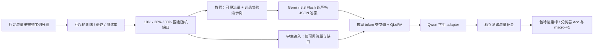

# ReSTC

**Retrieval-Enhanced Structured Traffic Completion**

检索增强的结构化流量补全框架 · 当前补全模型：**Gemini 3.8 Flash**

[分类结果网页](http://100.100.0.38:8879/prompt-study/gemini-native/) · [英文 Prompt](prompts/restc_system.en.txt) · [完整请求实例](prompts/example_request.json) · [运行配置](environment/active_method.json)

ReSTC 根据可见包检索相似训练流量，将原始位置、方向和长度编码成无损 JSON，通过严格 JSON Schema 生成缺失包，再将补全后的流量送入 CNN、LSTM、GRU、TST、SDAE、FS-Net 分类器。分类表保留 Baseline、TFI 和 Luna 对照。

<a id="run"></a>
## 运行

所有实验在 WSL 执行。现有数据、环境和缓存已配置：

```bash
cd /root/Document/data/-nuwa-results
/root/.local/venvs/nuwa-gemini/bin/python src/gemini/run.py prepare
/root/.local/venvs/nuwa-gemini/bin/python src/gemini/run.py run
```

`prepare` 校验冻结输入和来源；`run` 复用已完成响应，只在缺少响应时调用 API。当前 10%、20%、30% 各 64 条响应均已完成。Google ADC 凭据由 WSL 管理，不存入仓库。

运行入口委托给配置指定的 WSL 实验目录。仅克隆仓库还需要准备数据、权重和该实验目录；它不是不依赖外部文件的独立安装包。

<a id="prompt"></a>
## Prompt 与结构化输出

| 文件 | 内容 |
|---|---|
| [prompts/restc_system.en.txt](prompts/restc_system.en.txt) | 实际使用的英文系统 Prompt |
| [prompts/example_request.json](prompts/example_request.json) | 一条真实 Gemini 请求：系统 Prompt、输入 JSON、输出 Schema |
| [prompts/manifest.json](prompts/manifest.json) | 提示词来源、原始请求位置和 SHA-256 |

已核对三档共 **192 条请求**，系统 Prompt 逐字一致。输入的 `training_examples` 来自原训练集，仅根据目标的可见位置检索；`target` 保留原始位置、方向 P/N、长度与缺口。输出形如 `{"values":{"4":1500,"6":-52}}`（格式示例），每个缺失位置恰好对应一个非零带符号整数，绝对值为 1–1600。输出 Schema 按每条流量的缺失位置生成。

系统 Prompt 由实验目录中的 `structured_study.py`（`SYSTEM`、`body()`）与 `study.py`（`EXPLANATION`、`RLE`、`DEMO`）构造。`prompts/` 是实际请求的可读快照；现有实验执行三档 `requests.json` 中的冻结请求。修改 Prompt 应生成新实验版本，不覆盖历史请求或结果。

<a id="results"></a>
## 实验结果与位置

[当前分类三线表](http://100.100.0.38:8879/prompt-study/gemini-native/)展示 Normal、Loss 10%、20%、30% 下的 **Acc 与六类 macro-F1**。Average 为六个分类器指标的算术平均。

本轮使用固定 64 条开发流量；59 条完整序列也出现在原训练集中。原六分类输出头缺失，因此冻结已有骨干，在原训练集 47,862 条、验证集 5,319 条上重训输出头，按验证损失选取后冻结。所有方法使用相同流量、掩码和权重。这是 USTC 八类到六类的工程适配，不能作为论文原始复现或独立测试集 SOTA。

实验根目录：`/root/Document/data/nuwa-prompt-study-20261117`。

| 相对实验根目录的位置 | 内容 |
|---|---|
| `gemini_38_rates_10_20_30/loss10/`、`loss20/`、`loss30/` | 三档固定请求、流量与原始响应 |
| `classification_10_20_30/heads/` | 新训练的六分类输出头和训练记录 |
| `classification_10_20_30/classification_summary.json` | 分类指标汇总 |
| `classification_10_20_30/classification_predictions.json` | 逐样本分类预测 |
| `classification_10_20_30/classification_metric_audit.json` | 独立指标重算 |
| `evaluation_assets/` | 六种分类器骨干权重及执行实现 |

仓库内的 [results/revised/metrics_合并132.json](results/revised/metrics_合并132.json) 和 [历史查看器](results/viewer/index.html)属于此前八类实验，和当前 ReSTC 的 64 条开发实验分开记录。`results/evidence/` 保存完整预测、掩码、检查点与执行代码 ZIP，均可直接解压。旧查看器可用 `python3 src/viewer/build.py` 重建；当前 ReSTC 网页构建入口在实验目录的 `classification_10_20_30/build_report.py`。

<a id="data"></a>
## 数据与 Git 范围

当前数据为 `data/d4_ustc/raw.pkl`。原始数据只保留在 WSL，已加入 `.gitignore` 并取消 Git 跟踪。新克隆仓库需另行准备数据。

数据目录继续纳入版本管理范围的内容为 `author_configs/`、`manifests/`、[dataset_summary.json](data/d4_ustc/dataset_summary.json) 和固定实验输入 `experiment_inputs.zip`。Prompt、配置和实验结果不因这条数据忽略规则被排除。

| 场景 | 来源 |
|---|---|
| d1 | [CIC-AAGM2017](https://www.unb.ca/cic/datasets/android-adware.html)；论文命名与作者代码所链 CIC-AndMal2017 存在差异，不能混作同一数据集 |
| d2 | [CIRA-CIC-DoHBrw-2020](https://www.unb.ca/cic/datasets/dohbrw-2020.html) |
| d3 | [CIC-IoT-2023](https://www.unb.ca/cic/datasets/iotdataset-2023.html) |
| d4 | [USTC-TFC2016](https://github.com/davidyslu/USTC-TFC2016)，当前本地实验来源 |

<a id="environment"></a>
## 环境

当前 WSL 解释器：`/root/.local/venvs/nuwa-gemini/bin/python`，已核对 Python **3.12.13**、PyTorch **2.7.1+cu128**。API 调用使用现有 Google 授权。

`environment/environment.yml`、`pip-list-server.txt`、`server_environment.json` 和根目录 `requirements.txt` 保留历史 Nüwa 依赖记录。历史 Miniforge 定义及 Torch 2.1.2 安装说明不等于当前 Gemini 实验环境，也未经本轮重新安装验证。原 PCAP 处理另需 tshark/Wireshark。

<a id="distillation"></a>
## 蒸馏与 LoRA 微调

**ReSTC 教师：Gemini 3.8 Flash；默认学生：Qwen3-4B-Instruct-2507。** 学生模型及固定权重版本可在 [distillation.json](environment/distillation.json) 中修改。蒸馏决定“向谁学习”，LoRA 决定“更新哪些参数”：此处使用 Gemini 生成的完整 JSON 答案做序列级知识蒸馏，通过 LoRA 更新学生的低秩参数。Gemini API 没有提供完整词表 logits，因此没有实现或声称使用 KL/logit 蒸馏。



教师拥有训练集检索示例，学生只看到目标的无损 RLE JSON；学生部署时不依赖 Gemini 或检索库。原始真值单独保存，只用于验证、评测，以及显式选择的 `--target truth` 监督学习对照。训练 Prompt 不含标签或被遮蔽的真实值。

- **数据隔离**：完整有符号包长序列的 SHA-256 决定组，同组只进入一个集合，比例为 80% / 10% / 10%；三个丢包率共享组划分。每个选中的唯一序列每档生成一条训练记录，不按重复频次重复训练。标签冲突计入审计。
- **教师检索**：只在训练分组中检索同长度流量，排除目标自身组；距离仅使用可见位置。取最多 4 条最近邻；无候选时证据列表为空，数量写入清单，不制造示例或补全答案。
- **监督目标**：仅 assistant 答案及结束 token 计算交叉熵，系统说明、输入、padding 的标签均为 `-100`。验证损失对照真实缺失值，按验证损失保存最优 adapter；测试集不参与选模型。
- **LoRA**：默认 rank 16、alpha 32、dropout 0.05、`all-linear`；NF4 4-bit 基座、double quantization、BF16 计算。基座冻结，只训练 LoRA 参数。配置 `quantization: "none"` 可做普通 LoRA。
- **输出处理**：学生采用 XGrammar 的 JSON Schema 约束解码，在生成阶段限制合法 token；结构约束不提供隐藏真值，也不保证数值准确。原始输出严格检查位置、重复键、整数范围与完整性。不修改可见包、不补默认值、不修复非法 JSON；学生无效输出记为拒答。包长 MAE 只统计有效输出并同时给出覆盖率；整体正确率把无效缺口计为错误。
- **可追溯性**：保存数据、请求、教师响应、配置及 adapter 哈希。数据超长直接报错，不静默截断；续训必须指定原 checkpoint 并保持训练配置一致。

代码按阶段组织，全部位于仓库内：

| 文件 | 实现 |
|---|---|
| [common.py](src/restc_distill/common.py) | JSON 校验、无损编码、恢复与哈希 |
| [data.py](src/restc_distill/data.py) | 分组划分、固定掩码、教师检索、蒸馏样本构建 |
| [teacher.py](src/restc_distill/teacher.py) | Vertex AI / ADC、JSON Schema、原始响应缓存与导出 |
| [student.py](src/restc_distill/student.py) | 答案 token 标签、LoRA/QLoRA、续训、adapter 保存与学生推理 |
| [evaluate.py](src/restc_distill/evaluate.py) | 包长/方向指标、六种现有分类器及 Acc/macro-F1 |
| [restc_student.en.txt](prompts/restc_student.en.txt) | 学生使用的英文 Prompt |
| [test_restc_distill.py](tests/test_restc_distill.py) | 数据隔离、严格校验、监督标签、LoRA 梯度和重载检查 |

### 在 WSL 运行

教师 **Gemini 3.8 Flash 通过 API 调用，无需下载权重**；本地训练的是 **Qwen3-4B-Instruct-2507 学生模型**。当前 WSL 已有完整的三个学生权重分片、数据和 Google ADC 授权配置。以下步骤在同一个 WSL 终端按顺序执行，每一步成功后再继续。

新环境 `/root/.local/venvs/restc-distill` 与现有 Gemini 环境分开，复用 WSL PyTorch 2.7.1+cu128。依赖固定在 [requirements-distillation.txt](environment/requirements-distillation.txt)。学生配置固定 revision，并开启 `local_files_only`；更换模型时需明确准备权重并更新配置。

1. **连接 WSL，打开持久终端。** 如果在 Mac 终端，先执行：

   ```bash
   ssh wsl-lan
   ```

   在 WSL 中打开 tmux：

   ```bash
   tmux new-session -A -s restc-distill
   ```

   进入 tmux 后设置环境。后续命令均在这个终端执行：

   ```bash
   cd /root/Document/data/-nuwa-results
   source /root/.local/venvs/restc-distill/bin/activate
   export PYTHONPATH="$PWD/src"
   export RESTC_RUN=/root/Document/data/restc-distillation-runs/experiment-v1
   ```

2. **下载或补齐权重。当前缓存完整，可以跳过。** 下载的固定版本必须和配置一致：

   ```bash
   hf download Qwen/Qwen3-4B-Instruct-2507 \
     --revision cdbee75f17c01a7cc42f958dc650907174af0554
   ```

3. **准备数据。** 默认 512 条唯一训练流量 × 10%、20%、30% 三档缺口，共 **1,536 条训练样本**；验证、测试各 64 条唯一流量 × 三档，各 **192 条样本**。需要调整样本量时，先修改 [distillation.json](environment/distillation.json)，再执行：

   ```bash
   python -m restc_distill prepare \
     --out "$RESTC_RUN/prepared"
   ```

4. **生成 Gemini 教师答案。** 此步骤实际调用 API，默认最多生成 1,536 条答案，计入当前 Google Cloud 项目用量。成功响应按请求哈希缓存；中断后可重跑同一命令，复用已完成的有效响应：

   ```bash
   python -m restc_distill teacher \
     --data "$RESTC_RUN/prepared" \
     --out "$RESTC_RUN/teacher"
   ```

5. **构建蒸馏训练集。** 将“可见流量与缺口 → 教师 JSON 答案”组成训练样本：

   ```bash
   python -m restc_distill build-sft \
     --data "$RESTC_RUN/prepared" \
     --responses "$RESTC_RUN/teacher" \
     --out "$RESTC_RUN/sft"
   ```

6. **启动学生蒸馏训练。** 默认 3 个 epoch、4-bit QLoRA、rank 16、学习率 0.0002；只更新 LoRA 参数，只对答案部分计算损失：

   ```bash
   python -m restc_distill train \
     --data "$RESTC_RUN/sft" \
     --out "$RESTC_RUN/student"
   ```

   最优 adapter 保存到 `$RESTC_RUN/student/adapter/`。它需要和原始 Qwen 基座共同加载，下一步会自动完成。

7. **用学生补全测试数据。**

   ```bash
   python -m restc_distill infer \
     --data "$RESTC_RUN/prepared" \
     --adapter "$RESTC_RUN/student/adapter" \
     --out "$RESTC_RUN/student-test.jsonl"
   ```

8. **计算补全指标与分类 Acc / F1。**

   ```bash
   python -m restc_distill evaluate \
     --data "$RESTC_RUN/prepared" \
     --predictions "ReSTC-student=$RESTC_RUN/student-test.jsonl" \
     --out "$RESTC_RUN/metrics.json" \
     --classifiers environment/distillation_classifiers.json \
     --allow-development-classifiers
   ```

   `$RESTC_RUN/metrics.json` 包含三档丢包率的补全指标，以及 Normal、Baseline、学生补全后的六分类器结果。现有分类器沿用旧划分训练，分类指标属于开发对照。只需包特征指标时，省略最后两项分类器参数。

运行中按 **Ctrl+B，松开，再按 D** 可离开 tmux，任务继续运行。重新连接 WSL 后恢复终端：

```bash
tmux attach -t restc-distill
```

新实验应换一个 `RESTC_RUN` 目录名；`prepare`、`build-sft` 和结果文件不覆盖已有输出。回到同一次实验时，在原 tmux 终端继续操作，或重新设置相同的环境变量。

快速验证可在 `teacher` 与 `build-sft` 上都加 `--limit 3`，训练加 `--max-steps 2 --validation-limit 3 --eval-steps 1`，使用独立输出目录。`infer --limit` 用于调试；正式评测要求覆盖完整冻结集合，不会静默缩小分母。续训示例：原 `train` 命令补 `--resume "$RESTC_RUN/student/checkpoint-50"`。

教师对照可运行 `teacher --split test --predictions "$RESTC_RUN/teacher-test.jsonl"`（同时提供 `--data`、`--out`）；评测通过多次 `--predictions 名称=文件` 合并教师、学生和 TFI 等方法。每条预测需有 `id`、`input_sha256`、`answer`，必须覆盖同一批流量和缺口。原来 64 条开发样本的 TFI 结果不能直接套到新分组测试集。

上面的分类评测会验证已有骨干、输出头和执行代码的 SHA-256，然后计算 Normal、Baseline 和各补全方法在每档丢包率的 Acc / 六类 macro-F1。现有分类器在原始划分上训练，与新分组测试集存在交叠，因此此开关明确输出 `independent_test: false`，只能作开发对照。独立分类结论需要按新分组协议重新训练分类器，不能只更换学生模型后宣称独立测试提升。

输出保存在仓库外的 `restc-distillation-runs/`，不提交原始数据、API 凭据或训练权重。框架验证记录见 [distillation_verification.json](docs/distillation_verification.json)；小规模训练检查只证明代码链路可运行，不代表蒸馏后准确率已经提升。 已完成 **27 项测试**、**3 条真实教师请求**、Qwen3-4B 的 **2 步 QLoRA 训练**、adapter 重载、**3/3 合法 JSON 输出**和六分类器执行检查。三个教师样本来自一条训练流量的三档缺口；三个推理样本来自另一条测试流量的三档缺口。

实现依据：[PEFT 量化与 QLoRA](https://huggingface.co/docs/peft/en/developer_guides/quantization)、[Transformers 对话模板](https://huggingface.co/docs/transformers/chat_templating)、[Qwen 官方模型说明](https://huggingface.co/Qwen/Qwen3-4B-Instruct-2507)、[XGrammar 官方接入示例](https://xgrammar.mlc.ai/docs/latest/start/quick_start.html)。

<a id="layout"></a>
## 目录与来源

| 目录 | 用途 |
|---|---|
| `src/gemini/` | ReSTC 运行入口 |
| `src/restc_distill/` | 教师答案蒸馏、LoRA/QLoRA 训练、学生推理与评测 |
| `src/classifiers/` | 本地分类器实现、六类映射与第三方许可 |
| `src/data_process/` 及原上游脚本 | Nüwa 数据预处理、预训练与 TFI 参考实现 |
| `prompts/` | 英文 Prompt、完整请求实例与来源清单 |
| `data/`、`models/` | 数据、固定输入与骨干权重来源 |
| `results/` | 历史指标、对照记录与证据归档 |
| `environment/` | 当前运行配置与历史环境记录 |
| `paper/` | [论文正文](paper/Nuwa_TON_2025.pdf)、[补充材料](paper/Nuwa_Supplementary_Material.pdf)及提取文本 |
| `docs/` | 文件校验、整理记录与历史来源 JSON |

上游 Nüwa 来源为 [Timeless-zfqi/Nuwa](https://github.com/Timeless-zfqi/Nuwa)，固定提交 `2d4d5bf3bfdf1f7c3b9a8bd310ace5baa49bcf65`。保留的上游脚本存在已知问题：`TFM.py` 缩进无效，`pre-training.py` 使用标准 collator，`impute_missing_features.py` 把 `list.append()` 返回值赋给 `n_pad`。实际工程评估实现另见 [execution_code.zip](results/evidence/execution_code.zip)。第三方 [Transformer 许可证](src/classifiers/transformer_reference/LICENSE)保留。

项目只保留本文件作为 Markdown 文档入口。历史上传说明和重复 README 已移至仓库外归档；恢复记录见 [documentation_cleanup.json](docs/documentation_cleanup.json)。此前编号目录的整理记录见 [cleanup_manifest.json](docs/cleanup_manifest.json)。`docs/provenance/` 中的 JSON 保留历史路径，当前文件清单见 [docs/manifest.json](docs/manifest.json)。
