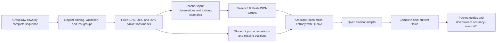

# ReSTC

**Retrieval-Enhanced Structured Traffic Completion**

Teacher and current API completion model: **Gemini 3.8 Flash**. Default distillation student: **Qwen3-4B-Instruct-2507**.

[Run ReSTC](#run) · [Distillation and LoRA](#distillation) · [WSL walkthrough](#wsl-run) · [Classification results (Tailscale)](http://100.100.0.38:8879/prompt-study/gemini-native/) · [Teacher prompt](prompts/restc_system.en.txt)

ReSTC retrieves similar training flows using observed packets, encodes packet positions, directions, and lengths as lossless JSON, and completes missing packets with a strict JSON Schema. Completed flows are evaluated with CNN, LSTM, GRU, TST, SDAE, and FS-Net classifiers. The current classification report includes Baseline, TFI, and Luna comparisons.

Repository: [nuwa-research-team/ReSTC](https://github.com/nuwa-research-team/ReSTC). The active WSL checkout is `/root/Document/data/ReSTC`.

<a id="run"></a>
## Run the existing Gemini experiment

Run all experiments on WSL. The current server already has the data, environment, and response cache:

```bash
cd /root/Document/data/ReSTC
/root/.local/venvs/nuwa-gemini/bin/python src/gemini/run.py prepare
/root/.local/venvs/nuwa-gemini/bin/python src/gemini/run.py run
```

`prepare` verifies frozen inputs and provenance. `run` reuses completed responses and calls the API only for missing responses. The current 10%, 20%, and 30% loss conditions each have 64 completed responses. Google Application Default Credentials (ADC) are managed on WSL and are not stored in Git.

This entry point delegates to the WSL experiment directory specified in [active_method.json](environment/active_method.json). A fresh clone also needs the data, weights, and external experiment directory; cloning alone does not reproduce that server setup. The distillation implementation below is included in this repository.

<a id="prompt"></a>
## Prompts and structured output

| File | Contents |
|---|---|
| [Teacher system prompt](prompts/restc_system.en.txt) | Exact English system prompt used by the current Gemini experiment |
| [Example request](prompts/example_request.json) | A real Gemini request containing the system prompt, JSON input, and output schema |
| [Prompt manifest](prompts/manifest.json) | Source locations, request identity, and SHA-256 checksums |
| [Student system prompt](prompts/restc_student.en.txt) | English prompt for the local distillation student |

All **192 requests** across the three loss conditions use the same teacher system prompt. `training_examples` come from the original training split and are retrieved using observed target positions only. `target` retains original positions, directions P/N, packet lengths, and missing slots.

An example output is `{"values":{"4":1500,"6":-52}}`. Every missing position must appear exactly once and map to a nonzero signed integer with magnitude 1–1600. Each request has a schema built from its own missing positions.

The teacher prompt is assembled by `structured_study.py` (`SYSTEM`, `body()`) and `study.py` (`EXPLANATION`, `RLE`, `DEMO`) in the external experiment directory. Files in `prompts/` are readable snapshots. Existing experiments execute their frozen `requests.json` files. Prompt changes should create a new experiment version rather than overwrite historical requests or results.

<a id="results"></a>
## Results and evaluation scope

The [current classification table](http://100.100.0.38:8879/prompt-study/gemini-native/) reports **accuracy and six-class macro-F1** under Normal, Loss 10%, Loss 20%, and Loss 30%. The Average row is the arithmetic mean across the six classifiers. The page is available through the configured Tailscale network.

This experiment uses 64 fixed development flows; 59 complete sequences also occur in the original training set. The original six-class output heads were unavailable, so new heads were trained on the original 47,862 training and 5,319 validation flows while keeping the existing backbones frozen. Heads were selected by validation loss and then frozen. All compared methods use the same flows, masks, and classifier weights.

These results are an engineering adaptation from eight USTC classes to six labels. They are not an exact reproduction of the paper or independent-test evidence of state-of-the-art performance.

Experiment root: `/root/Document/data/nuwa-prompt-study-20261117`.

| Path relative to the experiment root | Contents |
|---|---|
| `gemini_38_rates_10_20_30/loss10/`, `loss20/`, `loss30/` | Frozen requests, flows, and raw API responses |
| `classification_10_20_30/heads/` | Newly trained six-class heads and training records |
| `classification_10_20_30/classification_summary.json` | Classification metrics |
| `classification_10_20_30/classification_predictions.json` | Per-sample predictions |
| `classification_10_20_30/classification_metric_audit.json` | Independent metric recomputation |
| `evaluation_assets/` | Backbone weights and executable classifier implementations |

The repository's [merged historical metrics](results/revised/metrics_合并132.json) and [historical viewer](results/viewer/index.html) belong to earlier eight-class experiments. They are separate from the current 64-flow development experiment. `results/evidence/` contains ZIP archives of full predictions, masks, checkpoints, and execution code. Rebuild the historical viewer with `python3 src/viewer/build.py`. The current ReSTC report builder is `classification_10_20_30/build_report.py` in the external experiment directory.

<a id="data"></a>
## Data and Git tracking

The local dataset is `data/d4_ustc/raw.pkl`. It remains on WSL, is ignored by Git, and has been removed from the current Git index. New checkouts must obtain the dataset separately.

Tracked data assets include `author_configs/`, `manifests/`, [dataset_summary.json](data/d4_ustc/dataset_summary.json), and the frozen small input archive `experiment_inputs.zip`. Prompts, configuration, and experiment results remain tracked.

| Scenario | Source |
|---|---|
| d1 | [CIC-AAGM2017](https://www.unb.ca/cic/datasets/android-adware.html). The paper's naming differs from the CIC-AndMal2017 link in the authors' code; these datasets must not be treated as interchangeable. |
| d2 | [CIRA-CIC-DoHBrw-2020](https://www.unb.ca/cic/datasets/dohbrw-2020.html) |
| d3 | [CIC-IoT-2023](https://www.unb.ca/cic/datasets/iotdataset-2023.html) |
| d4 | [USTC-TFC2016](https://github.com/davidyslu/USTC-TFC2016), the source of the current local experiments |

<a id="environment"></a>
## Environment

The existing Gemini experiment uses `/root/.local/venvs/nuwa-gemini/bin/python`, verified with Python **3.12.13** and PyTorch **2.7.1+cu128**. API calls use the existing Google authorization.

`environment/environment.yml`, `pip-list-server.txt`, `server_environment.json`, and the root `requirements.txt` preserve historical Nüwa dependency records. The historical Miniforge definition and Torch 2.1.2 installation instructions do not describe the current Gemini environment and were not reinstalled during this work. The original PCAP processing scripts additionally require tshark/Wireshark.

<a id="distillation"></a>
## Distillation and LoRA fine-tuning

**Teacher: Gemini 3.8 Flash. Default student: Qwen3-4B-Instruct-2507.** The student model, pinned revision, and training settings are defined in [distillation.json](environment/distillation.json).

This pipeline performs sequence-level knowledge distillation: Gemini generates complete JSON targets, and the student learns them through assistant-token cross-entropy. LoRA specifies which parameters are updated. The Gemini API does not expose full-vocabulary logits, so this implementation does not perform KL/logit distillation.



The teacher sees retrieved training examples. The student sees only the target's lossless run-length encoding, so student deployment does not require Gemini or a retrieval bank. Original ground truth is stored separately for validation, evaluation, and the explicit `--target truth` supervised-learning control. Student inputs contain neither class labels nor hidden target values.

- **Data isolation:** the SHA-256 of each complete signed-length sequence identifies its group. Groups are assigned to training, validation, or test with 80% / 10% / 10% proportions. All loss rates share this partition. Each selected unique target contributes one record per rate; duplicate frequency does not duplicate training records. Conflicting labels are audited.
- **Teacher retrieval:** retrieve up to four nearest training groups of the same sequence length, excluding the target's own group. Distance uses observed positions only. An empty candidate set produces an empty evidence list, recorded in the manifest; no examples or answers are fabricated.
- **Training objective:** only assistant answer tokens and the end token contribute to cross-entropy. System instructions, user inputs, and padding use labels of `-100`. Validation loss is computed against true missing values, and the best adapter is selected by validation loss. Test data is not used for selection.
- **LoRA:** defaults are rank 16, alpha 32, dropout 0.05, and `all-linear` targets. QLoRA uses an NF4 4-bit base model, double quantization, and BF16 computation. The base model is frozen; only LoRA parameters are trained. Set `quantization` to `"none"` for ordinary LoRA.
- **Structured generation:** XGrammar applies per-input JSON Schema constraints during token generation. Structure constraints do not supply hidden values or establish numerical accuracy. Outputs are checked for exact positions, duplicate keys, integer bounds, and completeness. Observed packets are preserved. Invalid outputs are abstentions, without default filling or JSON repair. Length MAE covers valid outputs and is accompanied by coverage; overall accuracy counts invalid slots as errors.
- **Provenance:** data, requests, teacher responses, configuration, and adapters are hashed. Overlength data raises an error instead of being silently truncated. Resuming training requires an explicit checkpoint and matching run settings.

| File | Responsibility |
|---|---|
| [common.py](src/restc_distill/common.py) | Strict JSON validation, lossless encoding, reconstruction, and hashes |
| [data.py](src/restc_distill/data.py) | Group partitioning, fixed masks, teacher retrieval, and SFT dataset construction |
| [teacher.py](src/restc_distill/teacher.py) | Vertex AI / ADC, JSON Schema requests, response caching, and prediction export |
| [student.py](src/restc_distill/student.py) | Assistant-only labels, LoRA/QLoRA training, resume, adapter saving, and inference |
| [evaluate.py](src/restc_distill/evaluate.py) | Packet metrics and six-classifier accuracy / macro-F1 |
| [Student prompt](prompts/restc_student.en.txt) | English system prompt used by the student |
| [Tests](tests/test_restc_distill.py) | Isolation, strict validation, loss labels, LoRA gradients, and adapter reload checks |

<a id="wsl-run"></a>
### Step-by-step WSL walkthrough

Gemini 3.8 Flash is called through the API; no teacher weights need to be downloaded. The local student is Qwen3-4B-Instruct-2507. The current WSL server already has all three student weight shards, the dataset, and Google ADC configuration. Run the following steps in the same WSL terminal, continuing only after each step succeeds.

The separate environment `/root/.local/venvs/restc-distill` reuses WSL's PyTorch 2.7.1+cu128. Package versions are pinned in [requirements-distillation.txt](environment/requirements-distillation.txt). Student loading uses a pinned revision and `local_files_only`; a different student requires preparing its weights and updating the configuration explicitly.

1. **Connect to WSL and start a persistent terminal.** From a Mac terminal:

   ```bash
   ssh wsl-lan
   ```

   On WSL, start or attach to tmux:

   ```bash
   tmux new-session -A -s restc-distill
   ```

   Inside tmux, initialize the environment for all subsequent commands:

   ```bash
   cd /root/Document/data/ReSTC
   source /root/.local/venvs/restc-distill/bin/activate
   export PYTHONPATH="$PWD/src"
   export RESTC_RUN=/root/Document/data/restc-distillation-runs/experiment-v1
   ```

2. **Download or complete the student weights. Skip this on the configured server, where the cache is complete.** Use the revision pinned in the configuration:

   ```bash
   hf download Qwen/Qwen3-4B-Instruct-2507 \
     --revision cdbee75f17c01a7cc42f958dc650907174af0554
   ```

3. **Prepare the dataset.** Defaults are 512 unique training flows across three loss rates, giving **1,536 training records**. Validation and test each contain 64 unique flows across three rates, or **192 records** each. Edit [distillation.json](environment/distillation.json) before this step to change sample counts.

   ```bash
   python -m restc_distill prepare \
     --out "$RESTC_RUN/prepared"
   ```

4. **Generate Gemini teacher targets.** This makes real API calls and charges usage to the configured Google Cloud project. The default run generates up to 1,536 targets. Successful responses are cached by request hash; rerunning the same command reuses completed valid responses.

   ```bash
   python -m restc_distill teacher \
     --data "$RESTC_RUN/prepared" \
     --out "$RESTC_RUN/teacher"
   ```

5. **Build the distillation training set.** Each sample pairs observed traffic and missing positions with the teacher's JSON answer.

   ```bash
   python -m restc_distill build-sft \
     --data "$RESTC_RUN/prepared" \
     --responses "$RESTC_RUN/teacher" \
     --out "$RESTC_RUN/sft"
   ```

6. **Train the student.** Defaults are 3 epochs, 4-bit QLoRA, rank 16, and a learning rate of 0.0002. Only LoRA parameters are updated, and only answer tokens contribute to loss.

   ```bash
   python -m restc_distill train \
     --data "$RESTC_RUN/sft" \
     --out "$RESTC_RUN/student"
   ```

   The selected adapter is saved to `$RESTC_RUN/student/adapter/`. It must be loaded with the original Qwen base model; the next command handles both.

7. **Complete test flows with the student.**

   ```bash
   python -m restc_distill infer \
     --data "$RESTC_RUN/prepared" \
     --adapter "$RESTC_RUN/student/adapter" \
     --out "$RESTC_RUN/student-test.jsonl"
   ```

8. **Compute packet metrics and downstream accuracy / F1.**

   ```bash
   python -m restc_distill evaluate \
     --data "$RESTC_RUN/prepared" \
     --predictions "ReSTC-student=$RESTC_RUN/student-test.jsonl" \
     --out "$RESTC_RUN/metrics.json" \
     --classifiers environment/distillation_classifiers.json \
     --allow-development-classifiers
   ```

   `$RESTC_RUN/metrics.json` contains packet metrics and results for Normal, Baseline, and completed student flows across the six classifiers and three loss rates. Existing classifiers were trained under the original split, so these classification results are development comparisons. Omit the last two classifier options to compute packet metrics only.

To detach while keeping the job running, press **Ctrl+B**, release, then press **D**. After reconnecting to WSL, reattach with:

```bash
tmux attach -t restc-distill
```

Choose a new `RESTC_RUN` directory for a new experiment. Prepared data, SFT datasets, and result files are not overwritten. To continue an existing experiment, reuse its tmux terminal or restore the same environment variables.

For a small execution check, use `--limit 3` on both `teacher` and `build-sft`, then add `--max-steps 2 --validation-limit 3 --eval-steps 1` to `train`, using a separate output directory. `infer --limit` is for debugging; formal evaluation requires the complete frozen cohort. To resume training, append `--resume "$RESTC_RUN/student/checkpoint-50"` to the original training command with unchanged run settings and an existing checkpoint.

For a teacher comparison, run `teacher --split test --predictions "$RESTC_RUN/teacher-test.jsonl"`, also specifying `--data` and `--out`. Repeat `--predictions Name=file` during evaluation to compare teacher, student, and TFI predictions. Every record needs `id`, `input_sha256`, and `answer`, and every method must cover the same flows and masks. TFI results from the earlier 64-flow development cohort cannot be applied directly to the new grouped test split.

Classifier evaluation verifies the SHA-256 of the backbones, output heads, and execution code. It then reports accuracy and fixed-six-label macro-F1 for each loss condition. Historical classifier training overlaps the new grouped test split, so `--allow-development-classifiers` explicitly produces `independent_test: false`. Independent downstream conclusions require retraining classifiers under the new group partition.

Generated artifacts are stored outside the repository under `restc-distillation-runs/`. Raw datasets, API credentials, and training weights are not committed. [Verification records](docs/distillation_verification.json) document **27 passing tests**, **3 real teacher requests**, **2 QLoRA optimizer steps**, adapter reload, **3/3 schema-valid outputs**, and execution through all six classifiers. The three teacher examples are three masks of one training flow; the three inference cases are three masks of a different test flow. These checks establish that the framework runs; full training and accuracy improvements have not been established.

Implementation references: [PEFT quantization and QLoRA](https://huggingface.co/docs/peft/en/developer_guides/quantization), [Transformers chat templates](https://huggingface.co/docs/transformers/chat_templating), [the official Qwen model card](https://huggingface.co/Qwen/Qwen3-4B-Instruct-2507), and [the official XGrammar integration guide](https://xgrammar.mlc.ai/docs/latest/start/quick_start.html).

<a id="layout"></a>
## Repository layout and provenance

| Directory | Purpose |
|---|---|
| `src/gemini/` | Existing ReSTC Gemini experiment entry point |
| `src/restc_distill/` | Teacher distillation, LoRA/QLoRA training, student inference, and evaluation |
| `src/classifiers/` | Local classifiers, six-label mapping, and third-party license |
| `src/data_process/` and original upstream scripts | Nüwa preprocessing, pretraining, and reference TFI implementation |
| `prompts/` | English prompts, a complete request example, and provenance |
| `data/`, `models/` | Data, frozen inputs, and backbone provenance |
| `results/` | Historical metrics, reference comparisons, and evidence archives |
| `environment/` | Current configuration and historical environment records |
| `paper/` | [Main paper](paper/Nuwa_TON_2025.pdf), [supplementary material](paper/Nuwa_Supplementary_Material.pdf), and extracted text |
| `docs/` | File checksums, cleanup records, migration records, and historical provenance JSON |

The upstream Nüwa reference is [Timeless-zfqi/Nuwa](https://github.com/Timeless-zfqi/Nuwa), pinned to commit `2d4d5bf3bfdf1f7c3b9a8bd310ace5baa49bcf65`. Preserved upstream scripts have known issues: invalid indentation in `TFM.py`, use of a standard collator in `pre-training.py`, and assignment of the return value of `list.append()` to `n_pad` in `impute_missing_features.py`. The actual engineering evaluation implementation is also archived in [execution_code.zip](results/evidence/execution_code.zip). The third-party [Transformer license](src/classifiers/transformer_reference/LICENSE) is retained.

This README is the only Markdown documentation entry point. Duplicate documentation and obsolete numbered directories were archived outside the repository; see [documentation cleanup](docs/documentation_cleanup.json) and [layout cleanup](docs/cleanup_manifest.json). Historical audit and provenance records retain their original execution paths. The [path migration record](docs/path_migration.json) maps the former checkout location to `/root/Document/data/ReSTC` and records changes to active runtime references. [docs/manifest.json](docs/manifest.json) contains the current repository file checksums.
